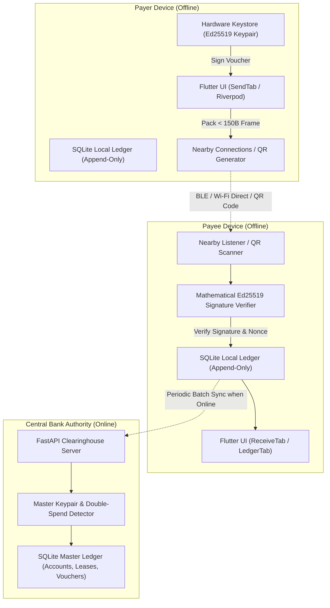

# OffPay (AirBirr) - Zero-Trust Offline Digital Payments

[](https://github.com/eyobassayie/AirBirr/actions/workflows/ci.yml)
[](https://flutter.dev)
[](https://pub.dev/packages/cryptography)
[](LICENSE)

OffPay (AirBirr) is an offline-first peer-to-peer digital payment system designed for cash-dominant, low-connectivity, and intermittent-power environments. Users can exchange cryptographically signed, double-spend-resistant digital payment vouchers peer-to-peer using short-range radio signals (Bluetooth Low Energy / Wi-Fi Direct) or high-density QR codes without an active internet connection.

---

## 🏛️ Core Architectural Principles & Constraints

1. **Persistent Keypair Generation**:
   A single Ed25519 keypair is generated once during initial wallet onboarding and permanently stored in the hardware-backed keystore (Android Keystore / iOS Keychain via `flutter_secure_storage`). New keypairs are **never** regenerated per transaction.

2. **Deterministic Cryptographic Signatures**:
   All payment vouchers are signed deterministically using Ed25519 asymmetric cryptography. Tampered vouchers fail mathematical verification and are discarded before touching local storage.

3. **Append-Only Immutable Ledger**:
   The local database (`sqflite`) enforces an append-only ledger for all received payment vouchers. Transactions cannot be deleted or mutated locally. Every incoming transaction must be mathematically verified before insertion.

4. **Sub-150-Byte Binary Frame**:
   Offline payment payloads are packed into a compact binary format (< 150 bytes; currently 60 bytes raw payload + 64 bytes signature = 124 bytes total) to guarantee reliable, instantaneous transmission over low-bandwidth P2P radio bursts.

5. **Replay & Double-Spend Protection**:
   Strict monotonic sequence nonces (`uint32`) prevent replay attacks. Offline spending leases issued by the Central Bank constrain maximum offline expenditure until subsequent on-chain settlement.

---

## 🏗️ System Architecture



---

## 📁 Repository Structure

```
AirBirr/
├── .github/
│   ├── pull_request_template.md       # Standard pull request description template
│   └── workflows/
│       └── ci.yml                     # Automated GitHub Actions test pipeline
├── android/                           # Native Android platform runner & Gradle config
├── ios/                               # Native iOS platform runner & Xcode config
├── backend/                           # Central Bank clearinghouse backend
│   ├── main.py                        # FastAPI settlement authority & SQLite master DB
│   └── test_backend.py                # 15-step automated integration test suite
├── docs/
│   └── pull_requests/                 # Pull request documentation archive (PR #1 - PR #6)
├── lib/                               # Flutter application source code
│   ├── main.dart                      # Application bootstrap & AppGatekeeper routing
│   ├── screens/                       # Presentation screens and tabs
│   │   ├── main_shell.dart            # Bottom navigation bar container
│   │   ├── home_tab.dart              # Wallet balance and quick actions
│   │   ├── send_tab.dart              # P2P & QR payment dispatcher
│   │   ├── receive_tab.dart           # P2P & QR payment receiver
│   │   ├── ledger_tab.dart            # Transaction history & bank sync
│   │   ├── register_screen.dart       # Bank registration & certificate fetch
│   │   └── pin_login_screen.dart      # 4-digit PIN authentication
│   ├── services/                      # Core business logic & domain services
│   │   ├── crypto_service.dart        # Ed25519 signing, verification & Keystore
│   │   ├── database_service.dart      # SQLite append-only ledger & nonce tracking
│   │   ├── nearby_service.dart        # Nearby Connections P2P transport
│   │   └── api_service.dart           # Central Bank REST client
│   ├── theme/
│   │   └── app_theme.dart             # Material 3 dark/light fintech theme
│   ├── utils/
│   │   └── phone_utils.dart           # Ethiopian phone number normalizer
│   └── widgets/                       # Reusable UI widgets
│       ├── network_status_bar.dart    # Connectivity & radio state banner
│       ├── qr_scanner_screen.dart     # Camera QR scanner
│       └── server_settings_dialog.dart# Custom backend endpoint configuration
├── test/                              # Comprehensive test suite
│   ├── crypto_service_test.dart       # Ed25519 unit tests
│   ├── database_service_test.dart     # SQLite ledger unit tests
│   ├── nearby_service_test.dart       # P2P transport unit tests
│   ├── api_service_test.dart          # Bank API client tests
│   ├── pin_auth_test.dart             # PIN authentication & lockout tests
│   ├── register_on_bank_test.dart     # Bank registration flow tests
│   ├── multi_screen_test.dart         # Multi-screen navigation tests
│   └── widget_test.dart               # Component & dashboard widget tests
├── tools/
│   └── ed25519_keygen.dart            # Standalone Ed25519 key generation tool
└── pubspec.yaml                       # Flutter package dependencies
```

---

## 🔀 Pull Request & Branch Architecture

This repository follows professional git discipline with atomic commits, conventional commit syntax, and structured pull requests:

| PR # | Branch | Summary | Key Commits |
| :--- | :--- | :--- | :--- |
| **#1** | [`feat/core-crypto-service`](file:///home/eyob/Projects/AirBirr/docs/pull_requests/PR-01-core-crypto-service.md) | Ed25519 Cryptography & Secure Keystore Engine | `feat(crypto)`, `test(crypto)`, `tools` |
| **#2** | [`feat/ledger-database-engine`](file:///home/eyob/Projects/AirBirr/docs/pull_requests/PR-02-ledger-database-engine.md) | SQLite Append-Only Transaction Ledger & Nonce Auditing | `feat(database)`, `feat(utils)`, `test(database)` |
| **#3** | [`feat/p2p-and-api-sync`](file:///home/eyob/Projects/AirBirr/docs/pull_requests/PR-03-p2p-and-api-sync.md) | Offline P2P Transport & Bank Sync API Client | `feat(p2p)`, `feat(api)`, `test(sync)` |
| **#4** | [`feat/bank-settlement-backend`](file:///home/eyob/Projects/AirBirr/docs/pull_requests/PR-04-bank-settlement-backend.md) | Central Bank Clearinghouse & Voucher Settlement Backend | `feat(backend)`, `test(backend)` |
| **#5** | [`feat/wallet-ui-and-theme`](file:///home/eyob/Projects/AirBirr/docs/pull_requests/PR-05-wallet-ui-and-theme.md) | Offline Wallet UI Screens, Theme & Riverpod Controllers | `feat(ui)`, `feat(app)` |
| **#6** | [`test/e2e-and-docs`](file:///home/eyob/Projects/AirBirr/docs/pull_requests/PR-06-e2e-and-docs.md) | E2E Integration Tests, CI Pipeline & Documentation | `test(ui)`, `test(e2e)`, `ci`, `docs` |
| **#7** | [`feat/neon-cloud-and-client-polish`](file:///home/eyob/Projects/AirBirr/docs/pull_requests/PR-07-neon-cloud-and-client-polish.md) | Neon Cloud PostgreSQL, Production Config & Client Polish | `feat(backend)`, `feat(ui)`, `test(backend)`, `chore(env)` |

Detailed pull request summaries and verification steps are archived under [`docs/pull_requests/`](file:///home/eyob/Projects/AirBirr/docs/pull_requests/).

---

## 🚀 Getting Started

### 1. Prerequisites
- **Flutter SDK**: 3.24+ (Dart 3.x)
- **Android SDK**: API 23+ (for Nearby Connections & Keystore)
- **Python**: 3.10+ (for central bank clearinghouse backend)

### 2. Running the Central Bank Clearinghouse Backend
```bash
# Navigate to backend directory
cd backend

# Install dependencies
pip install fastapi uvicorn cryptography pydantic

# Run the automated backend integration test suite
python test_backend.py

# Start the clearinghouse server on port 8000
uvicorn main:app --host 0.0.0.0 --port 8000 --reload
```

### 3. Running the Flutter Mobile App
```bash
# Install dependencies
flutter pub get

# Run unit and widget tests
flutter test

# Run app on connected device or emulator
flutter run
```

---

## 🔒 Security Specifications

- **Cryptographic Primitive**: Ed25519 (PureEd25519, 256-bit elliptic curve key, SHA-512 digest).
- **Voucher Payload Size**: Exact 60 bytes raw binary payload + 64 bytes signature = 124 bytes total wire size (comfortably below the 150-byte hard limit).
- **Key Storage**: Hardware-backed Android Keystore / iOS Secure Enclave accessed via `flutter_secure_storage`.
- **PIN Protection**: 4-digit PIN salted and hashed using Argon2 (`serverpod_argon2`).
- **Offline Ledger**: Append-only SQLite table with composite unique indices (`payer_public_key`, `nonce`) to prevent replay attacks.
